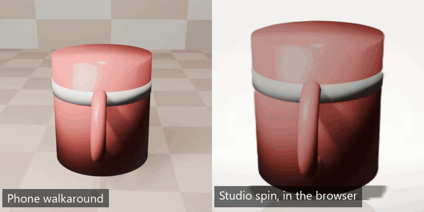
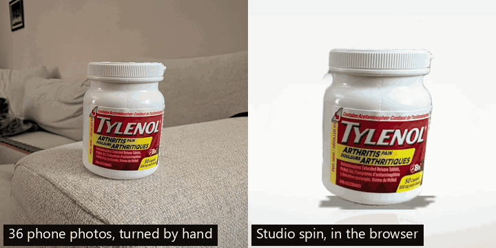
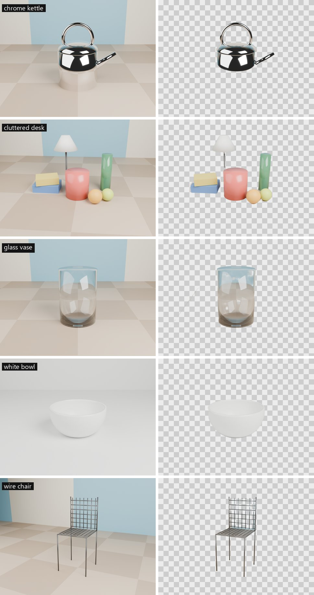

# Studio

**[Try it live](https://studio-cutouts-three.vercel.app)** · **[Benchmarks](https://studio-cutouts-three.vercel.app/bench.html)** · **[Real-phone showcase](#from-a-real-phone)** · **[Sample embed](https://studio-cutouts-three.vercel.app/embed/mug-spin.html)**



Product photos that never leave your device. Drop in a product photo, several photos, or a short phone video of the object turning (on a lazy Susan, with the phone held still) or of you walking around it. The browser cuts it out with a neural network I trained, stands it in a studio scene with a contact shadow and floor reflection, and turns several frames into a drag-to-spin 360° view. You can export a studio JPG, a 9:16 clip for social media, or a spin to embed on any site. Nothing is uploaded; there is no server.

## In 60 seconds

- **A model I trained myself, running in the browser.** Studio v1 is a 4.5M-parameter U-Net (9.1 MB) trained on public datasets plus synthetic composites, on one RTX 3070 in 55 minutes. It **beats the U²-Netp baseline on every metric** (+0.14 max F on fine-detail DIS-TE), reaches **98% of the 177 MB BiRefNet_lite** on everyday photos, and takes **14 ms per frame on a desktop GPU**.
- **A product pipeline, not a demo of one model.** Frame picking (sharpest of 3 per slot), cutout, stabilization, exposure matching across frames, studio rendering, a 360° viewer, video encoding and a self-contained embed, all client-side. A 5-second video becomes a 36-frame studio spin in about 3 s.
- **Measured, then decided.** Every choice above has a number behind it, including the ones where the first idea was wrong:
  - **fp16 overflow on WebGPU** silently wrecked about 1 in 7 masks. CPU-based export checks couldn't see it. I found it with a WebGPU-vs-CPU comparison and fixed it by keeping 8 operations in fp32.
  - **WebGPU was 3× slower than the CPU on a real Android phone.** So the app now times both backends on a device's first visit and keeps the faster one.
  - **Re-centering every frame added jitter** when checked against an independent measure. So the spin corrects only slow drift.
- **Honest about limits.** Glass, mirror-chrome, thin wire structures and cluttered scenes all fail in specific, documented ways, with a per-category comparison against BiRefNet showing where the gap is ([Where it fails](#where-it-fails)).

## From a real phone



36 photos of a pill bottle, turned by hand about 10° at a time on a couch armrest and sent over WhatsApp. Dropped into Studio, they became a 36-frame studio spin in **2.8 s** (18.8 ms per cutout on WebGPU). See it live and draggable on the [home page](https://studio-cutouts-three.vercel.app) or as a [standalone embed](https://studio-cutouts-three.vercel.app/showcase/pill-bottle-spin.html) (3.0 MB, with Play/Pause and a Studio | Original switch, since this one includes the source photos); there's also a [9:16 clip](docs/showcase-clip.mp4) and a [studio JPG](docs/showcase-studio.jpg).

What's left of the unevenness is in the photos themselves. Tracking how far the label slides between photos puts the hand-turned steps at roughly 8°–18° (one pair is nearly identical), adding up to about 360°. The viewer's crossfade hides most of that. A turntable video, or marks every 10° on a sheet under the object, removes it at the source. Automatic re-timing was tried and rejected: the same tracking reads a plain red mug's perfectly even orbit as steps from 0° to 30°.

This capture also found a bug. WhatsApp names photos sent in the same second "x.jpeg", "x (1).jpeg", "x (2).jpeg", and a plain name sort puts "x (1)" before "x.jpeg", so the first photo of every second landed last and the spin jumped back and forth. Names are now compared without their extension (`compareFileNames`, tested on these exact names).

## Results

**Quality** on the full public test sets, each image scored at its own resolution:

| Model | Download | Runs in browser | DIS-TE max F | IoU | MAE | DUTS-TE max F | IoU | MAE |
|---|---|---|---|---|---|---|---|---|
| BiRefNet_lite @1024 (large reference) | 177 MB | No | 0.953 | 0.902 | 0.013 | 0.884 | 0.811 | 0.036 |
| U²-Netp @320 (baseline) | 4.6 MB | Yes | 0.637 | 0.392 | 0.147 | 0.852 | 0.739 | 0.053 |
| **Studio v1 @512** | 9.1 MB | Yes | **0.774** | **0.623** | **0.085** | **0.867** | **0.761** | **0.049** |

DIS-TE (2,000 images) is fine detail: chairs, bikes, plants, jewelry. DUTS-TE (5,019) is everyday photos. Bold marks the best browser model. Training details and the evaluation code are in [training/](training/README.md).

**Speed**, median ms per frame, from the [benchmark page](https://studio-cutouts-three.vercel.app/bench.html), which times any device and copies the results as JSON:

| Device | Studio v1 WebGPU | Studio v1 WASM | U²-Netp WebGPU | U²-Netp WASM |
|---|---|---|---|---|
| Desktop, Chrome, RTX 3070 | **14 @512** | 229 @384 | 40 @320 | 1,422 @320 |
| Android 10 phone, Chrome, Imagination D-Series GPU | 510 @512 | **183 @384** | 1,595 @320 | 1,306 @320 |

**Finding one full turn.** People rarely stop a turntable at exactly 360°. The app compares every candidate frame with the first and keeps the video up to the moment the object comes back to its starting view. On the turntable sample, which turns 1.5 times in 6 s, it finds the turn at **4.0 s**, exactly where the render completes one rotation. Seam size (the jump from the last spin frame back to the first, divided by an average step; 1.0 is seamless):

| | Seam |
|---|---|
| 36 frames over the whole video (before) | 1.84, and the spin turns 1.5 times per loop |
| 36 frames over the detected turn | **0.86** |

**360° spin**, from the 5-second sample walkaround: 108 candidate frames scored, 36 kept, all cut out and placed in about **3 s**.

**Steadiness**, frame-to-frame wobble in % of object height (mean). Sideways is measured on the object's bottom band, which the stabilizer doesn't use as its reference. The top-edge bounce is measured on the rendered spin.

| Capture | Camera detected as | Sideways: raw → spin | Top-edge bounce in the spin |
|---|---|---|---|
| Walkaround (handheld video) | moving | 3.32% → **0.10%** | **0.22%** |
| [Real-phone bottle photos](#from-a-real-phone) | moving | 1.20% → **0.23%** | **0.17%** |
| Turntable (phone still) | still | already steady: 0.18% at the top | — |

**Exports** from the same spin:

| Export | Time | Size |
|---|---|---|
| 9:16 clip, 1080×1920, 8 s (two turns), H.264 MP4 | 1.2 s, faster than real time | 1.4 MB ([`docs/mug-clip.mp4`](docs/mug-clip.mp4)) |
| Embeddable spin, 36 frames at 800 px | 1.4 s | 0.39 MB, one HTML file ([live](https://studio-cutouts-three.vercel.app/embed/mug-spin.html)) |

The embed needs no server, script tag or third-party request. Its autoplay crossfades between frames like the clip does, which hides small uneven steps in hand-turned photos. It has a Play/Pause button (autoplaying motion needs a way to stop it) and, if you tick "Include original photos" when exporting, a Studio | Original switch. The originals load only when someone picks Original. Upload the file anywhere and paste:

```html
<iframe src="https://your-site.example/studio-spin.html" width="600" height="600"
  style="border:0;max-width:100%;height:auto;aspect-ratio:1" loading="lazy" title="360° product view"></iframe>
```

## Where it fails



Five scenes rendered to stress known weaknesses ([`tools/render_hard_cases.py`](tools/render_hard_cases.py)), shown in alphabetical order:

| Case | Result |
|---|---|
| **Chrome kettle** | ❌ The lower body mirrors the floor and gets cut away as background; only the dome, handle and spout survive. A mirror shows its surroundings, which is exactly what a saliency model learns to discard. |
| **Cluttered desk** | ❌ Everything is kept: lamp, books, bottle, fruit. The model finds "the salient things", not "the product"; it has no way to know which one you're selling. |
| **Glass vase** | 🟡 The outline is right, but the cutout is opaque, so the old floor stays visible inside the glass. A mask can't represent transparency; that needs alpha matting. |
| **White bowl** | ✅ Clean, despite almost no contrast with the set. |
| **Wire chair** | 🟡 Legs and wires survive, but the wall stays visible through the backrest's grid cells. |

The same pattern at scale: every DIS-TE image scored with both models and grouped by object category ([`results/dis-te-categories.md`](training/results/dis-te-categories.md), 98 categories with 8 or more images):

| Studio v1's hardest categories | IoU | BiRefNet_lite | | Studio v1's easiest categories | IoU | BiRefNet_lite |
|---|---|---|---|---|---|---|
| Street lamp | 0.32 | 0.88 | | Helicopter | 0.82 | 0.93 |
| Rope | 0.41 | 0.87 | | Truck | 0.82 | 0.95 |
| Scaffold | 0.41 | 0.76 | | Car | 0.82 | 0.96 |
| Floor lamp | 0.44 | 0.94 | | Archery | 0.81 | 0.93 |
| Hammock | 0.44 | 0.82 | | Harp | 0.81 | 0.93 |

Thin, sparse structures are where the small model loses most (gaps of +0.33 to +0.56 IoU). Compact solid objects, which is what most products are, are where it's closest (+0.11 to +0.19).

## How it works

```
files ──► frames.ts   one photo (≤4096 px) │ several photos, sorted by name │ a video: score 108 moments
              │       for sharpness on a 160 px copy, find where one full turn ends (loop.ts),
              │       keep the sharpest of every 3 within that turn → 36 frames (≤1024 px)
              ▼
          worker      each frame: RGB/255 → ONNX Runtime Web (WebGPU 512 px, else WASM 384 px) → alpha
              ▼
          pipeline    per frame: object box (ignoring stray specks) + mean colour of the object
              │       across frames: median-smooth the boxes, match exposure to the median frame,
              │       scale every frame to the same object height, stand it on the floor line
              ▼
          scene/spin  backdrop + contact shadow + floor reflection + object; drag, arrow keys, autoplay
              ▼
          exports     studio JPG (1080×1080) · transparent PNG cropped to the object
                      9:16 clip (1080×1920 MP4, WebCodecs via Mediabunny; real-time recording fallback)
                      embeddable spin (one HTML file: frames as WebP data URIs + a 2 KB viewer)
```

- **Inference runs in a Web Worker**, one message at a time, so the page never freezes and two model runs never overlap.
- **The backend is measured, not assumed.** On a device's first visit the worker times the model on the CPU (WASM), then on the GPU (WebGPU). It keeps the GPU unless the CPU is at least 20% faster, since the GPU runs the sharper 512 px input. The choice is saved, so later visits skip the probe.
- **One input size per backend.** Changing size makes WebGPU recompile its shaders (120–830 ms). 512 px was picked on validation data: max F 0.732 at 320 px against 0.774 at 512 px.
- **The model is "RGB/255 in, alpha out".** Normalization and the sigmoid are inside the exported graph. `src/models.ts` records each model's contract, which is how the U²-Netp baseline still runs side by side (`?model=u2netp`).
- **Models are cached** under versioned file names, so a second visit loads without a network request.
- **Exports never trust input.** The embed file can only contain validated base64 images and a colour, so nothing a user drops in can inject markup into a host page (`src/embed.test.ts`).

## Engineering notes

- **fp16 overflowed on WebGPU, and CPU checks couldn't see it.** The first spin test cut out a ghost of the mug.
  - **Cause:** Studio v1's squeeze-and-excitation blocks average a whole feature map, 256×256 values at 512 px input. ONNX Runtime's WebGPU backend sums that in fp16, which overflows past 65,504. The CPU sums in fp32, so the export's CPU parity check passed.
  - **Measured:** on 23 images compared WebGPU against the CPU, the fp16 model broke 3 at 512 px; fp32 broke none.
  - **Fix:** keep just those 8 `ReduceMean` operations in fp32 (`FP32_OPS` in `training/studio_train/export.py`). The file is the same 9.1 MB, scores the same on DIS-TE (0.7735), and now agrees with the CPU on all 23 (mean IoU 0.99).
  - **Shipping:** the model is now `studio-v1.1.fp16.onnx`, so returning visitors don't keep the cached broken file.
- **WebGPU isn't always faster.** On an Android 10 phone with an Imagination D-Series GPU, Studio v1 took 510 ms per frame on WebGPU and 183 ms on one CPU thread. The first version always chose WebGPU, which made that phone about 3× slower. Hence the first-visit probe, confirmed on the same phone afterwards.
- **Re-center only if the camera moved; I got this wrong first.**
  - **Centering on the bounding box** made the mug jump sideways as its handle swung into view.
  - **Centering on the median column of the object's pixels, smoothed over 5 frames,** lagged behind the swinging handle and added jitter. So the first version corrected only slow drift.
  - **The real-phone showcase showed what that cost:** the bottle still shifted 1.38% of its height per photo.
  - **Measured on a part of the object the anchor doesn't use,** centering *every* frame (unsmoothed) on the object's axis wins clearly: the axis is the midpoint of its top-band and bottom-band centers, which skips mid-height handles. Bottle photos went to 0.23%, the walkaround to 0.10%.
  - **On a still turntable** the same rule only adds noise (0.18% → 2.8%), because there's no camera motion to remove.
  - **So the stabilizer now checks** how far the object's top shifts between frames (median above 0.5% of its height means handheld) and picks the anchor accordingly.
  - **The same goes for size and floor position.** Smoothing them over 5 frames left a visible bounce on photos shot from a different distance (the bottle's top edge jumped 1.07% per frame on average, up to 3.5%). Handheld captures are now normalized one frame at a time: 0.17%, max 0.8%.
- **BiRefNet's ONNX export ran at about one image per minute** on CUDA, because `deform_conv2d` has no native ONNX operator. It was scored with its original PyTorch code instead (pinned, reviewed revision): about 130 ms per image.
- **Multithreaded WASM hangs inside a Web Worker** (ONNX Runtime Web 1.31.1), so the worker uses one thread. The upside: the site needs no cross-origin isolation headers, which keeps static hosting and embedding simple.

## What I'd do next

1. **Guided capture for walkarounds.** Handheld walkarounds are hard to shoot because the camera's height and tilt drift, which no 2D correction can undo; the turntable method avoids it. For walkarounds, the phone's motion sensors could show a live level indicator against the starting pose and take a frame automatically every 10° of heading. Frames shot at a tilt could be straightened afterwards.
2. **Close the thin-structure gap.** Train at 768 px or more, weight DIS5K's thin categories more, and add an edge-refinement stage. That's where the gap to BiRefNet sits (see the category table).
3. **Clean-license model.** Retrain on Open Images V7 masks (CC BY 4.0) and my own photos, so the weights can be used commercially. The current ones inherit DUTS and DIS5K's research-only terms.
4. **Alpha matting** for glass and other translucent products, and a touch-up brush for the cases a model will always miss: mirrors, and "which item is the product?".
5. **Safari and iPhone testing.** WebGPU there is new, WebP encoding falls back to JPEG, and video seeking has known quirks. None of it is verified yet.
6. **Smaller runtime download:** load ONNX Runtime's WASM-only build on devices where the CPU wins the probe.

## Run it

```bash
npm install
npm run dev      # http://localhost:5173 (benchmarks at /bench.html)
npm test         # 73 unit tests: tensors, stabilization, loop detection, colour, sharpness, clip timing, embed safety
npm run build    # static site in dist/, deployable to Vercel or any static host
```

Training, evaluation, the failure analysis and the gallery are in [training/](training/README.md) (Python, 24 tests).

| Path | What's there |
|---|---|
| `src/` | The app: worker, pipeline, stabilization, scene, spin viewer, exports, benchmark page |
| `training/` | Model, synthetic data, training loop, ONNX export, evaluation, failure analysis |
| `tools/` | Blender scripts for the sample videos (walkaround, turntable) and hard cases; a dev-only plugin that saves sample exports |
| `docs/` | Hero GIF, real-phone showcase, failure gallery, sample clips |

## Credits and licenses

- Code: MIT (see `LICENSE`).
- Studio v1 weights: trained on DUTS and DIS5K, so they are for research and demo use only. See `NOTICE`.
- Baseline model: [U²-Net / U²-Netp](https://github.com/xuebinqin/U-2-Net) by Xuebin Qin et al., Apache-2.0. ONNX export from [rembg](https://github.com/danielgatis/rembg).
- Reference model: [BiRefNet_lite](https://huggingface.co/ZhengPeng7/BiRefNet_lite) by Zheng Peng et al., MIT. Used for evaluation only.
- Inference: [ONNX Runtime Web](https://github.com/microsoft/onnxruntime), MIT.
- Clip muxing: [Mediabunny](https://github.com/Vanilagy/mediabunny), MPL-2.0, unmodified.
- Sample video, hard cases and gallery: rendered for this project in Blender ([`tools/`](tools/)); same license as the code.
- Showcase photos: taken by the author on a phone; same license as the code.
